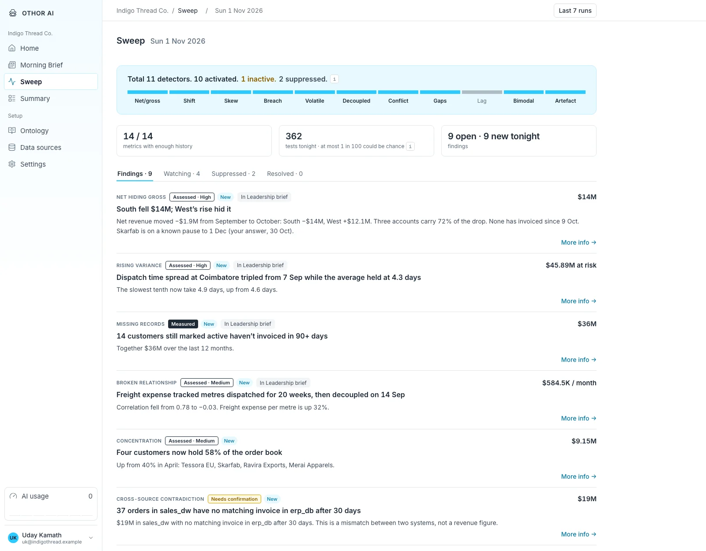
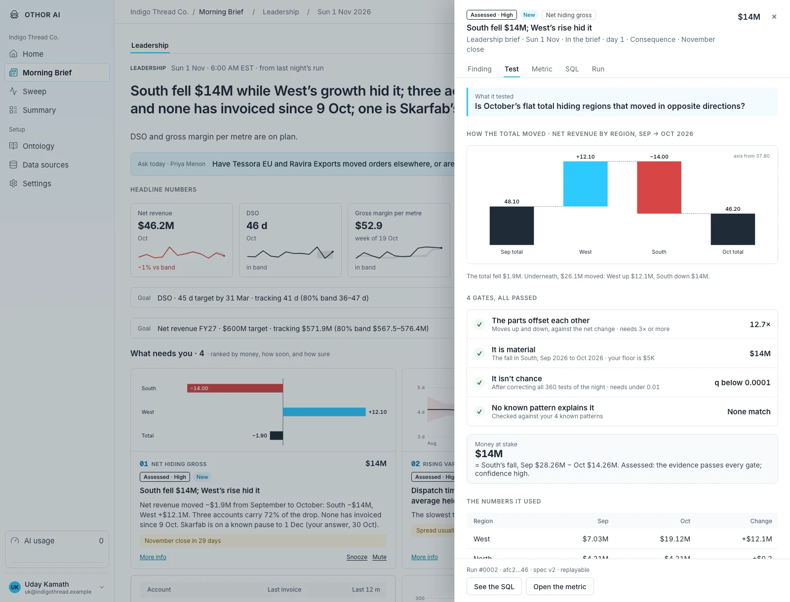

<div align="center">

<sub>A NEW SPECIES OF BUSINESS INTELLIGENCE</sub>

# Meet your Head of Intelligence.

**Built on the tradecraft of intelligence agencies** · **Grounded in a century of signal analysis** · **Numbers computed, never written by AI**

[Run it](#run-it) · [Self-host guide](docs/self-host.md) · [Contributing](CONTRIBUTING.md) · [othor.ai](https://othor.ai)

</div>

Every night Othor AI reads your systems, tests every number, and grades what it finds. By
06:00 you have the few things that matter, how sure each one is, and who to ask.


<sub>A Morning Brief for Indigo Thread Co., Othor AI's invented sample company.</sub>

## We solved the hardest problems in business intelligence, so you don't have to.

Until now, you had to pick which one to spend, and still got only part of the intelligence.
**Othor AI keeps AI and effort to a minimum, and intelligence at the maximum.**

| | AI usage | Human effort | Intelligence |
|---|---|---|---|
| **People do the work.** Analysts and dashboards. | Small | Lots of hours | Partial |
| **AI does the work.** Ask a model everything. | A big bill | Fewer hours | Partial |
| **Othor AI. Code does the work.** | Little | Little | Full |

What that looks like, measured on the sample company (205,000 rows, release 0.19):

| | AI bill | Your time |
|---|---|---|
| **Setup** | about $0.61, once | One afternoon: 5 steps, one source at a time |
| **Every day** | about 1¢ per brief; the nightly run uses none | 5 minutes with your brief each morning |

No AI key? It still works: every number, every test and the brief are computed by code, and the
sentences come from templates.

## See what your numbers are not showing.

**Detect every hidden signal.** Eleven tests run on every metric and every breakdown, every
night: the week a baseline moved, spreads widening before the average does, customers still
marked active who went quiet.

**Discover what your BI tools can't.** A total hiding a falling region, a few accounts carrying
most of the value, one number moving weeks before another, two systems disagreeing on the same
figure.

**Understand what shapes your business.** Each finding says what it means for the business, how
sure it is (*Measured*, *Assessed* or *Not determinable*), and the one question to ask, and of
whom.



## Every figure shows its working.

Open any finding to see what was tested, the gates it passed, the SQL, the metric's definition
and the run. Same inputs, same numbers: `othor replay <run_id>` reproduces any night byte for
byte, and CI fails if it doesn't.



## Built to be trusted with your numbers

- **AI drafts, code computes.** No number you see is written by a model. A model only drafts
  setup and the wording around the figures; a number in its text is replaced by the computed one.
- **Your data stays where it is.** PostgreSQL, MySQL and Google Sheets are read in place, with a
  login that can only read (one that can write is refused). Personal columns are never read, and
  no raw rows ever reach a model.
- **The night needs no model.** If the AI provider is down, the run, the findings and the brief's
  numbers don't notice.
- **On your own server.** One image, configured by environment variables and a data folder.
  Nothing calls home.

## Run it

You need a Linux server with Docker, and a domain pointing at it.

```sh
git clone https://github.com/othorai/othor-ai.git && cd othor-ai
cp .env.selfhost.example .env        # set OTHOR_DOMAIN, two secrets, your SMTP server
docker compose -f compose.selfhost.yml up -d
# open https://<your domain> and sign up: the first sign-up creates your company
```

HTTPS comes from Let's Encrypt automatically (or your own certificate on an internal network).
The full guide, with email, backups and upgrades: **[docs/self-host.md](docs/self-host.md)**.

## Open core

Everything in this repository is open source under **Apache-2.0**: use it, change it and run it,
for free. One install runs one company.

Enterprise features (several companies on one install, and more to come) come in a separate
image, `othor-ee`, under a commercial licence with a licence key. The hosted service is at
[othor.ai](https://othor.ai); for enterprise licences, write to support@othor.ai.

## Learn more

- [Contributing](CONTRIBUTING.md): run it from source, the rules every change keeps, the CLA
- [Security](SECURITY.md): how to report a vulnerability
- [Changelog](CHANGELOG.md)
- Licence: [Apache-2.0](LICENSE). "Othor AI" is a registered trademark
  ([TRADEMARKS.md](TRADEMARKS.md)).
