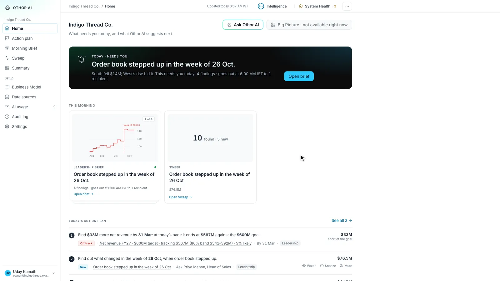
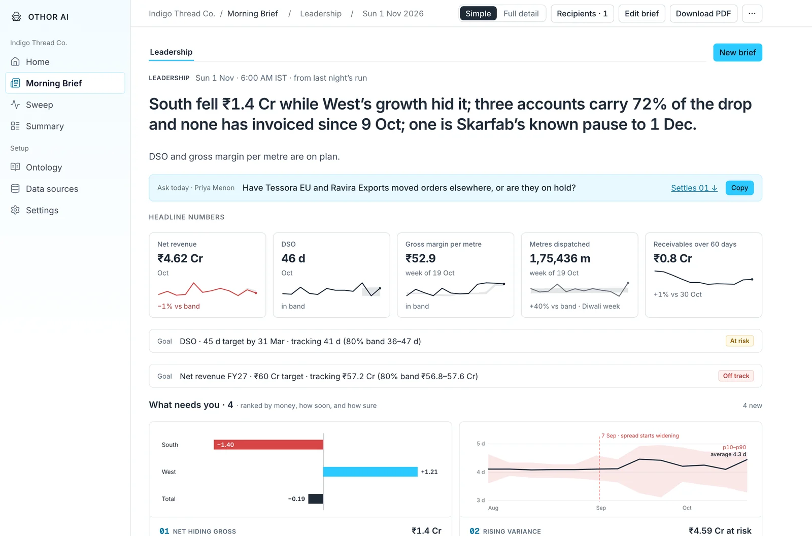

<div align="center">

<sub>A NEW SPECIES OF BUSINESS INTELLIGENCE</sub>

# Meet your Head of Intelligence.

**Analytic tradecraft as code** · **Classical signal analysis, not LLM guesswork** · **Every number computed, none generated**

[](LICENSE)
[](https://github.com/othorai/othor-ai/releases/latest)
[](pyproject.toml)
[](docs/self-host.md)



[What is Othor AI](#what-is-othor-ai-in-1-minute) · [Quick start](#quick-start) · [Architecture](#architecture) · [Self-hosting](docs/self-host.md) · [Contributing](CONTRIBUTING.md)

</div>

Othor AI is a self-hostable analytics engine that runs as a deterministic nightly batch. It
reads your operational databases in place, compiles a typed business model (the *Ontology*)
into SQL, materialises every metric and breakdown, runs a battery of statistical detectors with
false-discovery-rate control, forecasts each series, and emits a ranked, provenance-linked
**Morning Brief** at 06:00. A language model is confined to drafting setup and phrasing; it is
never on the path that produces a number.

## What is Othor AI, in 1 minute

https://github.com/user-attachments/assets/3eab7dbf-8a4a-48d9-aff0-de6144c224fa

A one-minute introduction: what Othor AI is, and the Morning Brief it writes every day.

### Why it exists

- **AI has made dashboards a commodity.** Charts and reports that took analysts weeks now take
  seconds. What's still scarce is knowing *what to look at*: Othor AI tests every metric and
  every breakdown, every night, and reports only what matters.
- **Built on two disciplines:** intelligence tradecraft (how agencies collect, grade, connect
  and report signals) and classical signal analysis (noise, detection, changes hidden in
  averages, relationships that lead and lag).
- **For the owner of a business or a group of companies,** not an analyst: it surfaces what
  shifts across plants, regions and companies, what teams don't raise, and what the owner never
  thought to ask.
- **Every finding carries its tradecraft:** how sure it is (Measured / Assessed / Not
  determinable), where it came from, what it means for the business, and one question for a
  named person.
- **Othor does the exploring.** It picks what to compare, tests it and reports in plain words.
  The reader never builds the analysis; any data-science term is one click away.

### Rules it never breaks

- **AI drafts, code computes.** No number shown, emailed, stored or ranked comes from a model. A
  model's output that contains a number is discarded or replaced by the computed value.
- **Same inputs, same numbers.** The nightly run is deterministic (pinned libraries, seeded
  routines, an append-only run ledger), and `othor replay <run_id>` reproduces any night byte
  for byte. CI fails if it doesn't.
- **Read-only, in place.** Sources are read through read-only credentials; a role that can write
  is refused. Personal columns are never read, and no raw rows go to a model.
- **The nightly run needs no model.** If the model provider is down, the run, the detectors, the
  forecasts and the brief's numbers still work; the prose falls back to templates.
- **Every figure has provenance.** Every number, finding, forecast and brief sentence can show
  its definition, SQL, test, parameters, spec version and run.
- **Nothing AI drafts goes live until a person applies it.**
- **Runs where your data lives.** One image, configured by environment and a data directory;
  nothing depends on a service only Othor could host.
- **Small bills.** Model tokens only for setup drafting and brief prose; incremental reads;
  results stored, not tables copied.


<sub>Rendered from Indigo Thread Co., the invented sample company the test suite generates.</sub>

## The design problem

Business intelligence usually spends one of two scarce resources and still under-delivers:

| Approach | Compute / tokens | Human effort | Coverage |
|---|---|---|---|
| **Dashboards + analysts**: humans author queries and read charts | Low | High: every question is hand-built | Only what someone thought to ask |
| **LLM-first agents**: a model plans queries and writes the answer | High, scales with data and questions | Lower | Non-deterministic; numbers can be hallucinated |
| **Othor AI**: a compiled spec, exhaustive tests, a model only for prose | Near zero at run time | Minimal | Every metric × every breakdown, every night |

Measured on the sample company (≈205k rows, 29 metrics, release 0.19, AWS `t3a.large`):

| | Cost | Wall time |
|---|---|---|
| **Setup** (model drafts the business model and metrics) | ≈ $0.61 in tokens, once | one afternoon of owner review |
| **Nightly run**: 294 hypothesis tests, 154 SQL queries | **0 model calls** | 28 s (47.9 s cold) |
| **Replay** of that night | 0 model calls | 15.8 s, byte-identical |
| **Brief prose** (optional) | ≈ 1¢ per brief | pages served in < 140 ms |

Without a model provider configured, everything above still runs; the prose layer falls back to
deterministic templates.

## Detection

Each night every series and breakdown goes through eleven detectors, each a pure function from a
materialised frame to typed results with a p-value, effect size and money at stake:

| Detector | Method |
|---|---|
| Net hiding gross | additive decomposition of a total; offsetting component moves against the net change |
| Changepoint | PELT (`ruptures`, L2 cost) on the weekly series, penalty scaled to the series' noise |
| Rising variance | dispersion (p10–p90 spread) trending while the level holds |
| Forecast breach | a closed period against the forecast stored *before* it (never a refit) |
| Broken relationship / Lead–lag | declared metric pairs: rolling correlation breaks; cross-correlation lag |
| Concentration | share of value held by the top-k entities, and its trend |
| Missing records | entities still flagged active with no events past their expected cadence |
| Process artefact | value distributions with suspicious mass (rounding, defaults, cut-offs) |
| Cross-source contradiction | the same fact in two systems, reconciled on shared keys |
| Bimodal average | Hartigan's dip test plus a 2-component Gaussian mixture by EM, selected by BIC |

All p-values in a run are corrected together with **Benjamini–Hochberg** (default q = 0.01).
Survivors pass materiality, known-pattern and dedup gates, then get an analytic grade borrowed
from intelligence tradecraft (**Measured**, **Assessed · High/Medium**, **Not determinable**),
and are ranked by money at stake, urgency and confidence.


**Forecasting** uses `statsmodels` `ETSModel` candidates chosen by AICc, then a rolling-origin
backtest per series: the candidate must beat a seasonal-naive (or last-value) baseline by a
margin or the baseline is used, and it abstains when history is too short. P10/P50/P90 bands
come from the chosen method's out-of-sample errors, widened until they would have covered its own
backtest; goals are projected against their targets.

## Determinism and provenance

- **Pinned everything:** `uv.lock`, base image by digest, Tailwind standalone binary by SHA-256.
  Randomised routines are seeded from `sha256(spec hash | run date | series id)`, never a run id
  or the clock.
- **Append-only, hash-chained run ledger:** `run_hash = sha256(prev | number | kind | spec | image | input | output)`.
  `othor replay <run_id>` re-executes a sealed run from its stored inputs and must produce the
  same bytes; CI fails otherwise.
- **Provenance on every figure:** definition, compiled SQL, test, parameters, spec version and
  run, one click from the UI.


## The model boundary

- One `ModelGateway`; every prompt is a versioned file, every call is logged with prompt id,
  version, token counts and an input hash (cached).
- **Numeric guard:** any numeral in model output that isn't in the computed input JSON fails the
  guard; the sentence is dropped or replaced from the computed value.
- Inputs are schema and computed summaries only: no raw rows, no personal columns. The engine
  can't import the AI layer at all (an `import-linter` contract in CI).

## Security model

- **Read-only, enforced:** the connection test inspects the login (PostgreSQL role attributes and
  object privileges, MySQL `SHOW GRANTS`) and refuses any role that can write or administer.
- **PII never read:** personal columns are classified at scan time and excluded from every query,
  sample and prompt; a query guard rejects SQL that names one.
- **Secrets:** source credentials encrypted with AES-256-GCM under a per-install instance key;
  nothing calls home. Enterprise licences are Ed25519-signed and verified offline.

## Architecture

```
sources (PostgreSQL · MySQL · Google Sheets, read-only, incremental)
   │
   ▼
Ontology (typed, versioned records) ──compile──▶ spec (SQL + rules, hashed)
   │
   ▼  nightly, APScheduler + idempotent job table
materialise → derive → probes → forecast → detect (BH-FDR) → grade → rank → brief → seal (ledger)
   │                                                                              │
   ▼                                                                              ▼
DuckDB + Parquet on the data volume (results, not copies)       Morning Brief: web · email (PNG charts) · PDF
```

Python 3.12 · FastAPI + Jinja2 + htmx (server-rendered, no SPA) · SQLAlchemy 2 + Alembic
(PostgreSQL, SQLite-compatible schema) · DuckDB / Parquet · pandas, numpy, scipy, statsmodels,
ruptures · charts as a `ChartSpec` rendered to SVG/PNG on the server · one container image,
configured by environment variables and a data directory.

## See it in 5 minutes

Needs Docker with Compose v2, [uv](https://docs.astral.sh/uv/) and `make`. It runs on Linux and
macOS as it is.

**Windows:** use a WSL 2 terminal for `make demo` and every other `make` command; PowerShell and
cmd won't run the Makefile. Check three things first:

- `wsl -l -v` (in PowerShell) lists your Linux distribution with `VERSION 2`; `wsl --set-version
  <distro> 2` converts it.
- Docker Desktop has WSL integration turned on for that distribution (Settings › Resources › WSL
  integration).
- Inside WSL, uv and `make` are installed (`sudo apt install make` on Ubuntu), and `docker version`
  answers with both a Client and a Server section.

```sh
git clone https://github.com/othorai/othor-ai.git && cd othor-ai
make demo                            # or: make demo CURRENCY=INR
```

This starts the app with its databases, loads Indigo Thread Co. (an invented textile company with
planted patterns) into a sample MySQL and PostgreSQL, sets it up in the app as an owner would
(sources connected read-only, Business Model confirmed, in US dollars and New York time) and runs
the night of 1 November 2026. It ends by printing a one-time sign-in link: open it within 15
minutes and you land on Home. Then open the Morning Brief, Sweep and the Business Model. No model
key is needed: the brief's sentences come from templates.

If the link has expired, sign in at http://othor.localhost:8000/login as
`owner@indigothread.example`; the six-digit code arrives in the bundled mail catcher at
http://localhost:8026. The stack uses host ports 8000, 8026, 1026, 5442, 5443 and 3307; if one is
taken, set `OTHOR_APP_PORT`, `OTHOR_MAILPIT_PORT`, `OTHOR_SMTP_PORT`, `OTHOR_META_DB_PORT`,
`OTHOR_SALES_DW_PORT` or `OTHOR_ERP_DB_PORT` before `make demo`. `make down` stops it.

## Quick start

```sh
git clone https://github.com/othorai/othor-ai.git && cd othor-ai
cp .env.selfhost.example .env        # OTHOR_DOMAIN, OTHOR_SECRET_KEY, POSTGRES_PASSWORD, OTHOR_SMTP_URL
docker compose -f compose.selfhost.yml up -d
```

Caddy terminates TLS (ACME, or an internal CA / your own certificate); `migrate` runs as a
one-shot service before `web` and `worker`. Details: **[docs/self-host.md](docs/self-host.md)**.

From source:

```sh
make dev && make seed                 # app, metadata Postgres, sample PostgreSQL/MySQL, Mailpit
make test                             # unit, detector goldens, integration, replay
othor run --company indigothread --date 2026-11-01
othor replay <run_id>
```

## Open core and Enterprise Edition

This repository is the **open core**. The **Enterprise Edition** (`othor-ee`) adds features
through the same plug-in entry-point group (`othor.plugins`) this repository exposes.

| | Open core (this repository) | Enterprise Edition |
|---|---|---|
| Nightly engine: every metric and breakdown, replayable byte for byte | ✓ | ✓ |
| All 11 detectors, with false-discovery-rate control | ✓ | ✓ |
| What’s ahead in every brief: each number’s forecast, each goal’s chance | ✓ | ✓ |
| Morning Brief (page, email, PDF), Sweep, Summary, Big Picture | ✓ | ✓ |
| Business Model, Ask Othor AI | ✓ | ✓ |
| Sources: PostgreSQL, MySQL, Google Sheets (read-only) | ✓ | ✓ |
| Look back: why a closed period went the way it did | | ✓ |
| Discover: groups of numbers your business isn't watching yet | | ✓ |
| Forecasts: a page of what’s ahead for every number, and how far it can see | | ✓ |
| Weekly Digest: your week as a newspaper’s data page, every Monday (page, email, PDF) | | ✓ |
| External signals: exchange rates, cotton, rainfall, tested against your numbers | | ✓ |
| Othor MCP: ask from Claude, ChatGPT or your own AI | | ✓ |
| Companies per install | One | Several |
| Licence | Apache-2.0 | Commercial licence key, verified offline |
| Support | Community (GitHub issues) | Enterprise-grade |

**Try the Enterprise Edition hosted:** a [14-day free trial on othor.ai](https://othor.ai), no
credit card needed.

[Contributing](CONTRIBUTING.md) · [Security](SECURITY.md) · [Changelog](CHANGELOG.md) ·
[Apache-2.0](LICENSE) · "Othor AI" is a registered trademark ([TRADEMARKS.md](TRADEMARKS.md))
